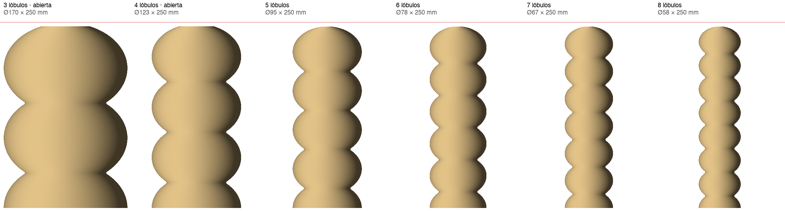

# Gusanito grande — 250 mm, lo más alto que entra en la A1

La A1 da 256 mm de Z, así que todas miden 250. Todas tienen la misma receta que
el Ø58 que ya se imprimió (PETG, cordón 1.2, capa 0.8, 480 mm/min, sin piso,
`--separacion marcha`). Lo único que cambia es **cuántos lóbulos** entran.

La regla del gusanito es que el paso entre lóbulos va atado al radio, así que
con la altura fija **el número de lóbulos decide el diámetro**:

    altura = radio x (0.7355 + 1.13 x (lobulos - 1))

| archivo | lóbulos | Ø | arriba | tiempo* | material | sin apoyo | peor puente | |
|---|---|---|---|---|---|---|---|---|
| g3_D170_boca68 | 3 | 170 | abierta Ø68 | 6.3 h | 220 g | 0.00 % | — | IMPRIMIBLE |
| g4_D123_boca49 | 4 | 123 | abierta Ø49 | 4.5 h | 158 g | 0.00 % | — | IMPRIMIBLE |
| g5_D95  | 5 | 95 | cerrada | 3.5 h | 122 g | 0.12 % | 10.1 mm | IMPRIMIBLE, justo |
| g6_D78  | 6 | 78 | cerrada | 2.9 h | 100 g | 0.18 % | 6.6 mm | IMPRIMIBLE |
| g7_D67  | 7 | 67 | cerrada | 2.5 h |  84 g | 0.05 % | 1.4 mm | IMPRIMIBLE |
| g8_D58  | 8 | 58 | cerrada | 2.2 h |  73 g | 0.22 % | 3.2 mm | IMPRIMIBLE |

\* Los tiempos salen de sumar el recorrido a la velocidad pedida. No es lo que
va a decir el laminador. Con esta misma cuenta, el Ø58×120 da 1.1 h y su LEEME
decía 1.5, así que es probable que las reales salgan ~35 % más largas.
Los verificadores completos están en `verif/`.

## Por qué más lóbulos es más rápido

Los lóbulos no cuestan tiempo: lo que cuesta es el DIÁMETRO. Todas tienen las
mismas ~312 vueltas (250 mm / 0.8), y cada vuelta mide lo que mide el
perímetro. Más lóbulos en la misma altura obliga a un gusano más flaco, y ese
gusano da vueltas más cortas. La cuenta cierra justa: de la de 3 a la de 8 el
diámetro baja 2.9 veces (170 → 58) y el tiempo también, 2.9 veces (6.3 → 2.2 h).

## Qué es el "peor puente"

Es el ÁPICE, no la pared. La pared de todas es la misma (son la misma forma
escalada) y ahí no hay nada al aire. Pero la punta de arriba es una cúpula, y
la impresora sube de a 0.8 mm: la última vuelta que alcanza a apoyarse queda a
cierto radio del centro, y ese agujerito que falta se cierra con un tramo
tendido al aire. Eso es el "puente".

No da igual en todas porque la cúpula NO se achica con la capa. En una pieza
grande la cúpula es más ancha y más plana, así que el último escalón de 0.8 mm
deja un agujero más grande (crece más o menos como la raíz del radio). Y
además depende de dónde cae justo la última vuelta respecto de la punta —a
veces cae casi en el ápice y a veces 0.7 mm antes—, por eso la de 8 (3.2 mm)
da más que la de 7 (1.4 mm) aunque sea más chica. Por encima de 12 mm el
tramo se descuelga.

## Por qué la de 3 y la de 4 van abiertas

Cerradas NO son imprimibles: el ápice es una cúpula, y cerrarla es un puente que
crece con el radio. Con Ø167 dio 39 mm al aire y con Ø121, 19 mm; el límite son 12. La de
5 (Ø95) todavía cierra, con 10.1 mm, pero es la que queda más al límite.

Abiertas se cortan donde el último lóbulo baja al 40 % de su radio (`recorte`),
y el radio se sube lo justo para que los lóbulos midan lo mismo que cerradas.
Probados también cortes al 64 % (en el cuello) y al 50 %: todos imprimibles,
con 0.00 % sin apoyo. Se eligió el 40 % porque es el que más se parece a
la forma cerrada.

## Lo que el verificador no ve

- **La primera vuelta** de la de Ø170 es un solo cordón de 1.2 sobre un
  círculo de medio metro de perímetro, sin piso. El Ø58 agarró bien, pero con
  este tamaño una esquina que se levante tira toda la pieza. Vale la pena
  pegamento en la cama o un brim.
- A 250 mm de alto y con una pared de 1.2, la pieza se va a mover con la
  boquilla arriba. La de 8 lóbulos (Ø58) es la más esbelta: 4.3 de alto por 1
  de ancho.

## Generar de nuevo

Los comandos exactos están en el `.params.json` de cada archivo.
