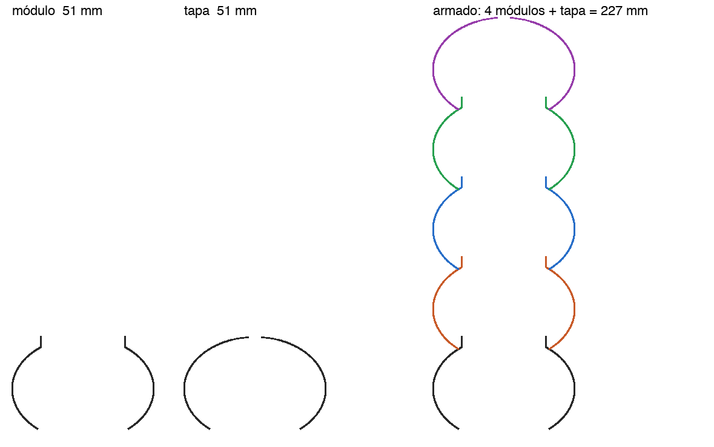
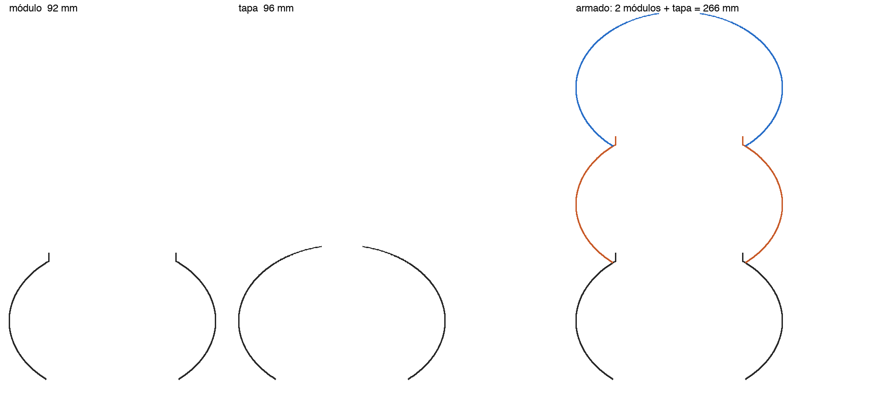

# Gusano modular — módulos que se apilan y una tapa

Es el gusanito en piezas sueltas. Cada **módulo** es un lóbulo; se imprimen los
que hagan falta y se apilan. La **tapa** es el mismo lóbulo cerrado arriba.
Misma receta que el gusanito grande (PETG, cordón 1.2, capa 0.8, 480 mm/min,
sin piso).

## Cómo encastra

- El módulo arranca abierto en el diámetro del **cuello**, se abre hasta el
  ecuador y cierra arriba en un **labio** vertical de 6 mm.
- El labio es más angosto que el cuello, así que entra por la boca del módulo
  de arriba, con 0.6 mm de juego por lado.
- La boca del de arriba se apoya en el hombro del de abajo, justo donde ese
  hombro vuelve a pasar por el diámetro del cuello.

Ese apoyo cae exactamente al paso del gusanito, así que armado da el mismo
gusano: mismos lóbulos y cuello en el mismo radio. La única diferencia es que
el cuello es una costura en V y no el cuello redondeado de la pieza entera.

No se traba: se apoya y el labio lo centra. Si hay que moverlo armado, lleva
una gota de pegamento en el hombro.

## Las piezas

Todas IMPRIMIBLE. Los módulos tienen 0.00 % sin apoyo y nada al aire.

| Ø | módulo | tiempo* | tapa | tiempo* | peor puente de la tapa |
|---|---|---|---|---|---|
| 58  | modulo_D58_40mm_labio6   | 0.3 h | tapa_D58_38mm           | 0.4 h | 0.4 mm |
| 78  | modulo_D78_51mm_labio6   | 0.6 h | tapa_D78_51mm           | 0.7 h | 5.2 mm |
| 95  | modulo_D95_61mm_labio6   | 0.8 h | tapa_D95_67mm           | 1.0 h | 7.4 mm |
| 120 | modulo_D120_75mm_labio6  | 1.3 h | tapa_D120_106mm (redonda, cerrada) | 1.8 h | 9.7 mm |
|     |                          |       | tapa_D120_77mm_boca24   | 1.4 h | — |
| 150 | modulo_D150_92mm_labio6  | 2.0 h | tapa_D150_96mm_boca30   | 2.2 h | — |
| 180 | modulo_D180_109mm_labio6 | 2.8 h | tapa_D180_116mm_boca36  | 3.2 h | — |

\* Calculados sobre el recorrido; lo real suele salir ~35 % más largo.

| Ø | cuello (boca de abajo) | labio | paso (lo que suma cada módulo) |
|---|---|---|---|
| 58  | 37.1  | 33.5  | 32.8  |
| 78  | 50.0  | 46.4  | 44.1  |
| 95  | 60.8  | 57.2  | 53.7  |
| 120 | 76.9  | 73.3  | 67.8  |
| 150 | 96.1  | 92.5  | 84.7  |
| 180 | 115.3 | 111.7 | 101.7 |

(diámetros del eje del cordón, en mm)

## Las tapas: cerrar la cúpula tiene un límite

La punta de la cúpula es un tramo al aire que crece con el radio, y a los
12 mm se descuelga (ver `gusanito-grande/LEEME.md`).

- **Ø58 y Ø78**: cierran con la misma proporción que el cuerpo.
- **Ø95**: con la proporción del cuerpo daba 12.6 mm. Estirada un 9 % baja a
  7.4 mm y queda 5 mm más alta.
- **Ø120**: cierra sólo si la cabeza es una esfera redonda (9.7 mm), y queda
  más grande que los lóbulos. Por eso va también `boca24`, que hace juego con
  el cuerpo y tiene un agujero de Ø24 arriba.
- **Ø150 y Ø180**: no cierran ni siendo redondas (17 y 23 mm al aire). Van
  abiertas, con una boca del 20 % del diámetro (Ø30 y Ø36) y la proporción del
  cuerpo: sin nada al aire. Para una lámpara, el agujero además deja salir el
  calor.

Los módulos Ø180 miden 180 de ancho: entran de sobra en la cama de 256 de la A1.
La primera vuelta es un cordón solo de 1.2 sobre un círculo de Ø115; con los
grandes vale la pena pegamento en la cama.

## Antes de hacer la tanda

La holgura de 0.6 mm es un cálculo, no una medición. **Imprimir primero dos
módulos de Ø58** (~20 min cada uno) y probar el encastre. Si queda
flojo o no entra:

    python gen_gusano_modular.py 58 --holgura 0.4

Los "pisados" del verificador (en `verif/`) están en la primera vuelta y en el
cierre de la cúpula, igual que en el gusanito; en la pared hay 0.

## Generar de nuevo

    python gen_gusano_modular.py              # Ø58, Ø78 y Ø95
    python gen_gusano_modular.py 120 150 180  # los grandes
    python gen_gusano_modular.py 70           # otro diámetro (verificar la tapa)
