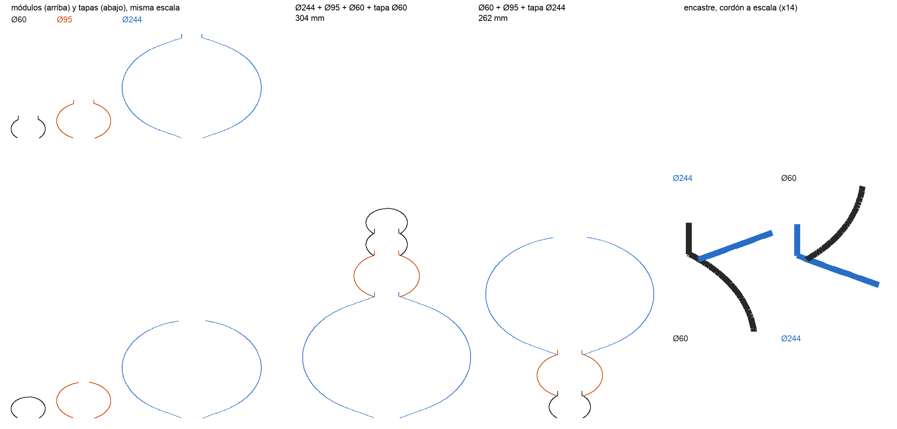

# Gusano universal — tres tamaños que se apilan en cualquier orden

Es el gusano modular, pero con módulos de **Ø60, Ø95 y Ø244** que encastran
entre sí en cualquier orden: un Ø60 sobre un Ø244, un Ø244 sobre un Ø95, lo
que sea. Para eso los tres comparten el mismo adaptador: la misma **boca**
abajo y el mismo **labio** arriba, sin importar el tamaño del lóbulo.
Usa la misma receta que el gusano modular (PETG, cordón 1.2, capa 0.8,
480 mm/min, sin piso).

## Cómo encastra

Es el mismo encastre del gusano modular, sólo que ahora el cuello es común:

- Todas las piezas arrancan en la cama abiertas en el **cuello común**, Ø38.4.
  Ese es el cuello del gusanito de la Kadzi (`0.6405 x 30`). Lo fija el más
  chico: el Ø60 no admite un cuello más ancho sin cambiar su cintura.
- Todos los módulos cierran arriba en el mismo **labio** vertical de 6 mm,
  Ø34.8, metido `pared + holgura` = 1.8 mm respecto del cuello.
- El labio del de abajo entra por la boca del de arriba con 0.6 mm de juego
  por lado. La boca se apoya donde el hombro del de abajo vuelve a pasar por
  el radio del cuello.

Como la boca y el labio son iguales en todas, el juego es el mismo para
cualquier par. El generador lo comprueba en las 18 combinaciones (3 módulos
abajo, 3 módulos o 3 tapas arriba) a lo largo de los 6 mm del labio: da
0.60 mm en todas. **El paso depende sólo de la pieza de abajo**. Lo que se
apoye encima no lo cambia.

Lo que cambia con el tamaño es **en qué punto del hombro** cierra el lóbulo
hacia ese cuello. El Ø60 es exactamente un lóbulo de la Kadzi, y apilados dan
ese gusanito con su paso de 31.7 mm. El Ø244 es casi un elipsoide entero,
porque Ø38 es apenas el 16 % de su diámetro.

Los tres lóbulos tienen la proporción de la Kadzi: semieje vertical =
0.6884 x radio, sacado de sus mismos números (5 lóbulos, 150 mm, apoyo 0.12).
El gusano modular usa 0.7355, que es la del gusanito grande, un 7 % más
estirado.

## Las medidas

Diámetros y alturas del **eje del cordón**, en mm:

| Ø | cuello (boca de abajo) | labio | paso (lo que suma) | alto del módulo | alto de la tapa | boca de la tapa |
|---|---|---|---|---|---|---|
| 60  | 38.43 | 34.83 | 31.72  | 38.68  | 36.51  | cerrada |
| 95  | 38.43 | 34.83 | 59.99  | 66.64  | 62.03  | Ø19.0 |
| 244 | 38.43 | 34.83 | 176.02 | 182.67 | 170.30 | Ø48.8 |

Una pila mide la suma de los pasos de los módulos más el alto de la tapa. Por
ejemplo, Ø244 + Ø95 + Ø60 + tapa Ø60 = 176.0 + 60.0 + 31.7 + 36.5 = 304 mm.

## Las piezas

Todas IMPRIMIBLE, con trazo continuo (sin viajes, sin retracciones y la Z
sólo sube). La columna "peor ángulo" es la de `verificar_tumbado.py` y va
explicada más abajo.

| archivo | tiempo* | material | sin apoyo | peor puente | peor ángulo |
|---|---|---|---|---|---|
| modulo_D60_39mm        | 0.4 h | 11 g  | 0.00 % | —      | 61.3° |
| tapa_D60_37mm          | 0.4 h | 12 g  | 0.30 % | 1.1 mm | 87.4° (ápice) |
| modulo_D95_67mm        | 1.0 h | 32 g  | 0.00 % | —      | 70.0° |
| tapa_D95_62mm_boca19   | 1.0 h | 32 g  | 0.00 % | —      | 80.9° (boca) |
| modulo_D244_183mm      | 6.5 h | 227 g | 0.00 % | —      | 70.0° |
| tapa_D244_170mm_boca49 | 6.4 h | 224 g | 0.00 % | —      | 81.7° (boca) |

\* Se calculan sumando el recorrido a la velocidad pedida, con la misma cuenta
que da 2.8 h para el módulo Ø180 del gusano modular. Lo real suele salir
~35 % más largo.

El Ø244 mide 244 de ancho y entra en la cama de 256 de la A1. Su módulo mide
183 mm de alto, contra 256 de Z.

## El problema: un lóbulo grande que cierra a un cuello angosto

Cerrar el Ø244 siguiendo su elipsoide hasta Ø38 deja la pared casi acostada:
84° desde la vertical, justo antes de la boca y justo después del labio. Es
el riesgo principal de todo esto, y **`verificar_pieza.py` no lo ve**. Con la
marcha vertical cada vuelta se corre 0.8 mm sobre la superficie y pisa la
anterior de costado. Por eso una pared a 84° da 0.00 % sin apoyo, igual que
una a 60°. Para poder elegir hacía falta otro número, así que se escribió
`verificar_tumbado.py`: el ángulo de la pared vuelta a vuelta, y cuánto radio
recorre por encima de 76° (la cintura de Squeezy) y de 80°. Separa la panza de
abajo, que se abre ("afuera"), del hombro de arriba, que se cierra
("adentro").

Hay una referencia que salva el caso, porque ya está impresa y salió bien:
`hongo/hongo_latest.gcode`, que es justamente el sombrero de 244.

### Lo que se probó (módulo Ø244)

| alternativa | alto | peor | > 76° afuera / adentro | > 80° afuera / adentro | verificar_pieza | pisados* |
|---|---|---|---|---|---|---|
| **hongo_latest (impreso)** | — | 84.0° | 7.1 / 26.0 mm | 2.4 / 19.0 mm | — | — |
| A. el elipsoide hasta el cuello común | 172.1 | 84.0° | 21.2 / 23.6 mm | 9.5 / 12.7 mm | IMPRIMIBLE | 6.22 % |
| C. cuello común Ø48 (el Ø60 con cintura 0.80) | 170.9 | 82.5° | 16.5 / 18.8 mm | 4.7 / 7.9 mm | IMPRIMIBLE | 6.37 % |
| B. hombro 76° | 175.5 | 76.0° | (justo en 76°) | nada | IMPRIMIBLE | 6.35 % |
| **B. hombro 70° (éste)** | **182.7** | **70.0°** | **nada** | **nada** | **IMPRIMIBLE** | **6.19 %** |
| B. hombro 60° | 204.1 | 60.0° | nada | nada | IMPRIMIBLE | 19.09 % |
| B. hombro 45° | 272.3 | 45.0° | — | — | no entra en la A1 (256) | — |

\* "pisados" es el criterio de CHOQUE del verificador. No entra en el
veredicto (marca el 39 % del jarrón impreso), pero sirve para comparar
versiones de la misma pieza.

- **A** es la figura pura y la que el verificador aprueba. El hombro de
  arriba ("adentro") cae dentro de lo que ya imprimió el hongo: el mismo peor
  ángulo y menos radio tumbado. La panza de abajo no. Tiene **3 veces** el
  radio por encima de 76° que el hongo (21.2 contra 7.1) y **4 veces** por
  encima de 80° (9.5 contra 2.4), en los primeros 4.5 mm sobre la cama. Ninguna
  pieza impresa del repo respalda eso. Se descarta por ese número, no porque se
  haya visto fallar.
- **C** ensancha el cuello todo lo que permite el Ø60 sin quedarse sin
  cintura (Ø48 obliga a cintura 0.80, y el gusanito pierde la forma), y casi
  no mejora: 82.5°. El problema no es el cuello sino el 16-20 % del diámetro.
- **B** es la idea de "en qué momento del lóbulo se hace el labio".
  `gusano_modulo(hombro=)` sigue el elipsoide hasta que su pared se tumba a
  ese ángulo y de ahí baja RECTO, en la tangente, hasta el cuello, igual
  abajo que arriba. Con 70° el Ø244 deja de seguir el elipsoide en Ø114: un
  cono de 13.8 mm de alto abajo y 14.4 arriba. Gana 10.6 mm de alto y no
  cambia ni el tiempo (6.5 h) ni el material (227 contra 226 g). Al Ø95 le
  agrega un cono de 3 mm de radio (0.3 mm de alto). **Al Ø60 no lo toca**: su
  pared no pasa de 61°, así que sigue siendo el lóbulo de la Kadzi.
- Con **76°** queda pegado al límite de Squeezy. Con **70°** sobra margen por
  7 mm de alto, y por eso es el elegido.
- **60°** ya se lee como un trompo, y los pisados saltan de 6 % a 19 % (31 %
  en su tapa). Ese salto no está explicado.
- **45°** no entra en la impresora.

Las tapas grandes siguen siendo cúpulas que cierran hacia la boca. La del
Ø244 llega a 81.7°, con 16.5 mm de radio por encima de 76°, adentro. Eso es
menos que el hongo impreso (84.0°, 26.0 mm).

## Las tapas

- **Ø60**: cerrada, 1.1 mm al aire en el ápice.
- **Ø95**: cerrada no es confiable. Con la proporción del cuerpo da
  **12.1 mm al aire: NO IMPRIMIBLE** (se descuelga a los 12). Estirándola, el
  resultado baila sin orden según dónde caiga la última vuelta contra el
  ápice: 0.74 da 12.5, 0.76 da 10.1, 0.77 da 8.2, 0.775 da 11.5, 0.78 da 8.4,
  0.785 da 10.5 y 0.80 da 9.9. Media centésima de diferencia la mueve
  3 mm. Por eso va **abierta, con una boca del 20 %** (Ø19). No tiene nada al
  aire y mantiene la proporción del módulo. Si se la quiere cerrada, 0.77 es
  la mejor que se midió (8.2 mm, 70.0 mm de alto), pero sin margen.
- **Ø244**: abierta al 20 % (Ø49), como las grandes del gusano modular.
  Cerrada no hace falta probarla: desde Ø150 la cúpula ya no cierra ni
  redonda (17 mm al aire). Para una lámpara, el agujero además deja salir el
  calor.

## `perfiles.json`: el contrato con la web

**Este archivo lo lee el visor 3D de Vacante** (el creador donde se apilan
módulos de tamaños mezclados) para dibujar los perfiles exactos de cada pieza.
Lo escribe `gen_gusano_universal.py` a partir de las mismas siluetas que
generan el g-code. No se edita a mano: se regenera.

Por tamaño (`"60"`, `"95"`, `"244"`):

| campo | qué es |
|---|---|
| `modulo`, `tapa` | el perfil como lista de `[z, r]` en mm, del **eje del cordón**. Son unas 160 muestras repartidas por largo de arco, con los quiebres (cono, labio) exactos. z va de 0 a la altura de la pieza. |
| `paso` | cuánto más arriba que la base de esta pieza queda la base de la siguiente al apilarla |
| `cuello` | radio de la boca de abajo (igual en los tres) |
| `labio` | radio del labio de arriba (igual en los tres) |
| `altura_modulo`, `altura_tapa` | alto de cada pieza (último z de su perfil) |
| `boca_tapa` | radio de la boca abierta arriba de la tapa; 0 = cerrada |
| `diametro` | el nombre del tamaño, como número |

Para armar una pila, la base de cada pieza va en la suma de los `paso` de las
de abajo. Arriba de todo va una `tapa`, o un módulo, que deja el labio a la
vista. Las superficies de afuera y de adentro quedan a ±0.6 mm del eje (el
cordón mide 1.2).

z = 0 es el plano de la primera vuelta. En el g-code la boquilla va 0.8 mm más
arriba (la primera capa). Medido contra el g-code con esa corrección, el
perfil se aparta 0.2 mm de mediana y 0.5 mm como mucho, en el ápice de la tapa
Ø244 (es la cuerda del polígono de 240 lados).

## Qué imprimir primero

La holgura de 0.6 mm es un cálculo, no una medición, y **es la misma en todos
los tamaños**: la boca y el labio son iguales en los tres. Así que el
encastre se prueba con lo más barato:

1. **Dos módulos Ø60** (~25 min cada uno). Encastrarlos. Si queda flojo o no
   entra:

       python gen_gusano_universal.py --holgura 0.4

   (rehace los tres tamaños, que tienen que seguir iguales entre sí).
2. **Un Ø95 sobre un Ø60** (1 h). Es el primer par mezclado, y la boca del
   Ø95 ya arranca en el cono del hombro.
3. Recién ahí, **el Ø244** (6.5 h, 227 g).

## Lo que el verificador no ve

- **Cada pieza arranca en la cama sobre un solo cordón de 1.2 en un círculo de
  Ø38**, sin piso, igual que el gusano modular. En el Ø244 eso es lo que
  sostiene una pieza de 244 x 183 mm y 227 g mientras la boquilla trabaja a
  12 cm del eje. Va con pegamento en la cama, y conviene vigilar las primeras
  vueltas.
- Por lo mismo, **una pila apoyada sobre su boca de abajo es inestable** si
  abajo va un tamaño grande. Una lámpara armada necesita base o soporte.
- Los 87.4° de la tapa Ø60 son los del ápice cerrado. Es el mismo número que
  da el ápice del gusanito de la Kadzi (87.4°).

## Generar de nuevo

    python gen_gusano_universal.py                 # los tres tamaños, verif/ y perfiles.json
    python gen_gusano_universal.py --solo-perfiles # sólo perfiles.json y armado.png
    python gen_gusano_universal.py 60 --holgura 0.4
    python gen_gusano_universal.py 244 --hombro 76 --carpeta prueba  # otra alternativa, aparte

`cuello` y `hombro` son parámetros nuevos de `siluetas.gusano_modulo`. En 0,
que es el valor por defecto, no cambian nada: las 13 piezas de
`gusano-modular/` regeneran el mismo g-code instrucción por instrucción
(verificado).
